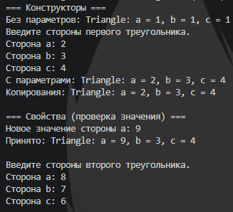
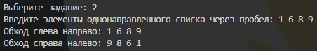

# Сисевич Дмитрий ЛА-4 Лабораторная №4

# Задание 1. List

## Задача 10

### Текст задачи

Составить программу, которая в списке L из каждой группы подряд идущих одинаковых элементов оставляет только один.

### Алгоритм решения

Метод `RemoveConsecutiveDuplicates(List<int> list)` выполняет один проход по списку двумя индексами:

1. Если в списке меньше двух элементов, список остаётся без изменений.
2. Индекс записи `writeIndex` = 1, индекс чтения `readIndex` идёт от 1 до конца списка.
3. Если `list[readIndex]` не равен последнему сохранённому элементу `list[writeIndex - 1]`, он записывается в позицию `writeIndex`, и `writeIndex` увеличивается на 1.
4. После прохода хвост списка, начиная с `writeIndex`, удаляется одним вызовом `RemoveRange`.

Сложность: O(n) по времени, O(1) по дополнительной памяти.

### Тестирование

# Задание 2. LinkedList

## Задача 10

### Текст задачи

Построить двунаправленный список L по однонаправленному списку L1.

### Алгоритм решения

Однонаправленный список представлен классом `SinglyLinkedNode` (значение и ссылка на следующий узел). Двунаправленным списком служит `LinkedList<int>`.

Метод `BuildDoublyLinkedList(SinglyLinkedNode? head)`:

1. Создаёт пустой `LinkedList<int>`.
2. Начиная с головы `head`, обходит узлы по ссылкам `Next` до `null`.
3. Значение каждого узла добавляется в конец результата методом `AddLast`.

Для проверки двунаправленности результат дополнительно обходится от `Last` к началу по ссылкам `Previous`.

Сложность: O(n) по времени.

### Тестирование

# Задание 3. HashSet

## Задача 10

### Текст задачи

Есть перечень факультативов в учебном заведении. Студенты группы записались на некоторые из этих факультативов. Известно для каждого студента, на какие факультативы он записан. Определить:

- на какие факультативы из перечня ходят все студенты группы;
- на какие факультативы из перечня ходит хотя бы один студент группы;
- на какие факультативы из перечня не ходит ни один из студентов группы?

### Алгоритм решения

Метод `AnalyzeElectives` принимает множество `electives` (перечень) и список множеств `students` (факультативы каждого студента):

1. `attendedByAll` – копия перечня. Для каждого студента выполняется `IntersectWith`, в итоге остаются факультативы, которые есть у всех.
2. `attendedBySome` – пустое множество. Для каждого студента выполняется `UnionWith`, затем `IntersectWith(electives)`, чтобы учитывались только факультативы из перечня.
3. `attendedByNone` – копия перечня, из которой выполнен `ExceptWith(attendedBySome)`.

Если список студентов пуст, выбрасывается `ArgumentException`.

### Тестирование

# Задание 4. HashSet

## Задача 10

### Текст задачи

Файл содержит текст на русском языке. Напечатать в алфавитном порядке символы, которые встречаются хотя бы однажды в словах с нечётными номерами (нумерацию вести с 1).

### Алгоритм решения

Метод `GetCharsFromOddWords(string path)` читает файл целиком и один раз проходит по его символам:

1. Словом считается непрерывная последовательность букв (`char.IsLetter`); любой другой символ является разделителем.
2. При переходе от разделителя к букве увеличивается номер слова `wordNumber`.
3. Если номер слова нечётный, буква (приведённая к нижнему регистру) добавляется в `SortedSet<char>`.
4. `SortedSet` автоматически хранит символы без повторов и в порядке возрастания кодов, то есть в алфавитном порядке (буква «ё» оказывается после «я»).

Сложность: O(n log k), где n – длина текста, k – число различных букв.

### Тестирование

# Задание 5. Dictionary

## Задача 10

### Текст задачи

На автозаправочных станциях (АЗС) продается бензин с маркировкой 92, 95 и 98. В городе N был проведен мониторинг цены бензина на различных АЗС. Напишите программу, которая будет определять для каждого вида бензина, сколько АЗС продают его дешевле всего.

На вход программе в первой строке подается число данных N о стоимости бензина. В каждой из последующих N строк находится информация в следующем формате:

`<Компания><Улица><Марка><Цена>`

где `<Компания>` – строка, состоящая не более, чем из 20 символов без пробелов, `<Улица>` – строка, состоящая не более, чем из 20 символов без пробелов, `<Марка>` – одно из чисел – 92, 95 или 98, `<Цена>` – целое число в диапазоне от 1000 до 3000, обозначающее стоимость одного литра бензина в копейках.

`<Компания>` и `<Улица>`, `<Улица>` и `<Марка>`, а также `<Марка>` и `<Цена>` разделены ровно одним пробелом. Пример входной строки:

`Синойл Цветочная 95 2250`

Программа должна выводить через пробел 3 числа – количество АЗС, продающих дешевле всего 92-й, 95-й и 98-й бензин соответственно. Если бензин какой-то марки нигде не продавался, то следует вывести 0.

Пример выходных данных:

`12 1 0`

### Алгоритм решения

Исходные данные хранятся в текстовом файле, который заполняет отдельный метод `FillGasInputFile` (ввод с консоли с проверкой формата каждой строки).

Метод `CountCheapestStations(string path)` читает файл построчно и обрабатывает данные за один проход, не хранит все записи в памяти:

1. Заводятся два словаря `Dictionary<int, int>` с ключами 92, 95, 98: минимальная цена `minPrices` (изначально `int.MaxValue`) и количество АЗС с этой ценой `counts` (изначально 0).
2. Каждая строка разбивается по пробелам и проверяется (4 части, длины названий, марка из набора, цена в диапазоне 1000–3000). При ошибке выбрасывается `FormatException`.
3. Если цена меньше текущего минимума для марки, минимум обновляется, а счётчик становится равным 1. Если цена равна минимуму, счётчик увеличивается на 1.
4. Результат – количества для марок 92, 95, 98 в виде массива из трёх чисел. Для марки, которая не встречалась, остаётся 0.

Сложность: O(N) по времени, O(1) по памяти.

### Тестирование

