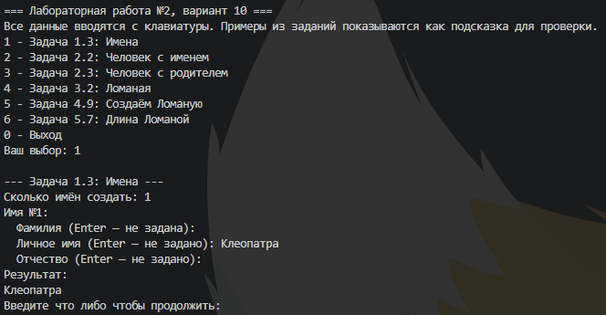
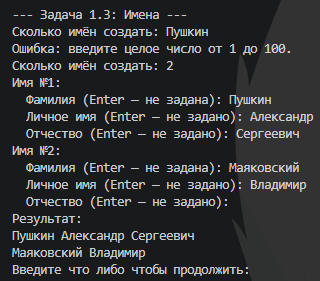
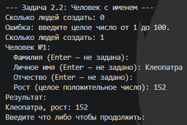
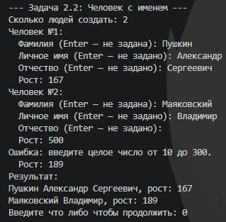
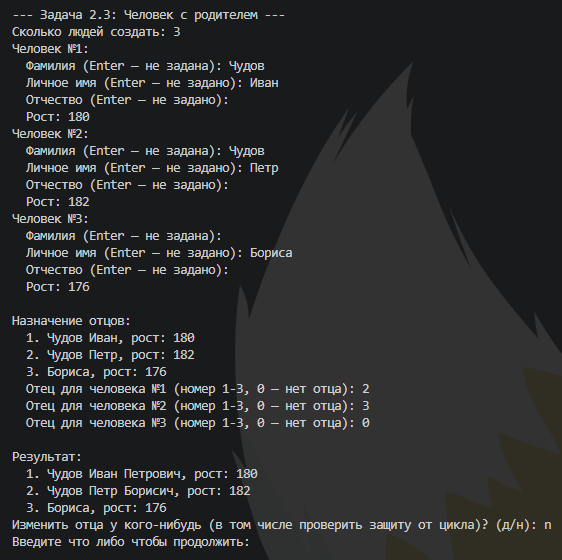
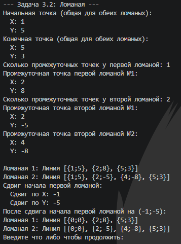
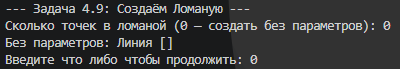
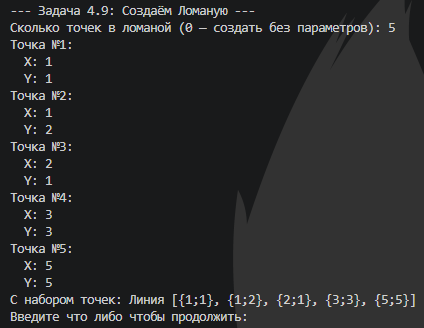
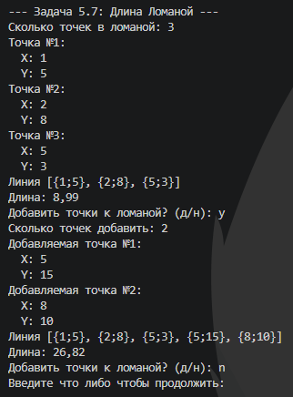

# Сисевич Дмитрий ЛА-4 Лабораторная №2

# Задание 1

## Задача 3. Имена

### Текст задачи

Создайте сущность Имя, которая описывается тремя параметрами: Фамилия, Личное имя, Отчество. Имя может быть приведено к строковому виду, включающему традиционное представление всех трех параметров: Фамилия Имя Отчество (например «Иванов Иван Иванович»). Необходимо предусмотреть возможность того, что какой-либо из параметров может быть не задан, и в этом случае он не учитывается при приведении к текстовому виду.

Необходимо создать следующие имена:

- Клеопатра
- Пушкин Александр Сергеевич
- Маяковский Владимир

Обратите внимание, что при выводе на экран не заданные параметры никак не участвуют в образовании строки.

### Алгоритм решения

1. Создаётся класс `Name` с тремя свойствами типа `string?`: `LastName` (фамилия), `FirstName` (личное имя), `MiddleName` (отчество). Тип допускает `null`, поэтому любой параметр может быть не задан.
2. Конструктор `Name(lastName = null, firstName = null, middleName = null)` принимает все три параметра, и у каждого есть значение по умолчанию `null`. Благодаря этому можно создать имя из любого набора частей, пропущенную часть при необходимости указывают по имени аргумента, например `new Name(firstName: "Клеопатра")`.
3. Метод `ToString()` помещает три части в массив в порядке «Фамилия, Имя, Отчество», в цикле `foreach` пропускает пустые и состоящие из пробелов значения (`string.IsNullOrWhiteSpace`), а остальные добавляет в `StringBuilder`, ставя между ними пробел. Поэтому незаданные части не оставляют в строке лишних пробелов.
4. В `Main` пользователь вводит с клавиатуры количество имён и для каждого — фамилию, личное имя и отчество (пустой ввод означает, что часть не задана). Строковые представления созданных имён выводятся на экран. Для проверки вводятся имена из условия: «Клеопатра» (только личное имя), «Пушкин Александр Сергеевич», «Маяковский Владимир».

### Тестирование

---

# Задание 2

## Задача 2. Человек с именем

### Текст задачи

Объедините сущности Человек из задачи 1.2 и Имя из задачи 1.3 таким образом, чтобы имя человека задавалось с использованием сущности 1.3, а не строки.

Необходимо объединить ранее созданные объекты имен и людей, с получением:

- Человека с Именем Клеопатра и ростом 152
- Человека с Именем Пушкин Александр Сергеевич и ростом 167
- Человека с Именем Маяковский Владимир и ростом 189

### Алгоритм решения

1. Создаётся класс `Person` со свойствами `Name` (тип `Name` из задачи 1.3) и `Height` (целое число). Имя хранится не строкой, а объектом `Name`.
2. Конструктор `Person(Name name, int height, Person? father = null)` принимает имя и рост. В конструкторе имя проверяется на `null`, а при присвоении роста срабатывает проверка в свойстве: рост должен быть положительным, иначе выбрасывается `ArgumentOutOfRangeException`.
3. Метод `ToString()` возвращает строку вида «Имя, рост: N», где имя берётся из `Name.ToString()`.
4. В `Main` пользователь вводит количество людей и для каждого — части имени и рост (с проверкой, что рост — целое положительное число). Строковые представления созданных людей выводятся на экран. Для проверки вводятся данные из условия: Клеопатра — 152, Пушкин Александр Сергеевич — 167, Маяковский Владимир — 189.

### Тестирование

## Задача 3. Человек с родителем

### Текст задачи

Измените сущность Человек из задачи 2.2 добавив ему возможность задавать третий параметр: Отец, где Отец — это тоже Человек. При приведении человека к строковой форме необходимо проверить параметры имени, и в зависимости от ситуации выполнить одно из следующих действий:

- Если у данного человека нет фамилии, и есть отец, у которого фамилия задана, то фамилию необходимо сделать такой же как у отца.
- Если у данного человека нет отчества, а у отца есть имя, то необходимо задать отчество как имя отца с добавлением суффикса «ович».

Затем необходимо выполнить следующие задачи:

1. Создать людей: Чудова Ивана, Чудова Петра, Бориса
2. Сделать Ивана отцом Петра, а Петра отцом Бориса
3. Вывести на экран строковое представление всех троих людей.

При желании можно попытаться реализовать систему в более полном виде: предусмотреть разные виды суффиксов отчества в зависимости от окончания имени, а также предусмотреть возможность задавать пол человека и менять суффикс отчества в зависимости от пола.

### Алгоритм решения

1. В класс `Person` добавляется свойство `Father` типа `Person?` (отец может отсутствовать). Конструктор получает отца необязательным третьим параметром.
2. В сеттере `Father` проверяется цепочка предков нового отца: если среди них оказывается сам человек, выбрасывается `ArgumentException`. Так нельзя создать циклическую связь «отец — сын».
3. Метод `GetFullName()` формирует полное имя с учётом отца, не изменяя исходный объект `Name`:
   - если у отца есть отец, его полное имя вычисляется рекурсивно, поэтому данные передаются по всей цепочке предков;
   - если у человека не задана фамилия, берётся фамилия из полного имени отца;
   - если не задано отчество, а у отца есть имя, отчество образуется от имени отца методом `CreatePatronymic`;
   - результат возвращается в виде нового объекта `Name`.
4. Метод `CreatePatronymic` подбирает суффикс по окончанию имени отца:
   - оканчивается на «й» или «ь» — окончание отбрасывается и добавляется «евич» (Игорь → Игоревич);
   - оканчивается на «а» или «я» — окончание отбрасывается и добавляется «ич» (Никита → Никитич);
   - оканчивается на другую гласную — добавляется «вич»;
   - оканчивается на согласную — добавляется «ович» (Иван → Иванович).
5. `ToString()` формирует строку «Полное имя, рост: N» на основе `GetFullName()`.
6. В `Main` пользователь вводит количество людей и данные каждого, затем для каждого человека указывает номер его отца (0 — отца нет). После этого выводятся строковые представления всех людей, а отцов можно изменить повторно. Для проверки вводятся Чудов Иван (180), Чудов Пётр (178) и Борис (175); отцом Петра назначается Иван, отцом Бориса — Пётр. В результате у Петра появляется отчество по имени Ивана, а у Бориса — фамилия Петра и отчество по имени Петра. Защита от цикла проверяется попыткой назначить Бориса отцом Ивана: программа выводит сообщение об ошибке, и отец не меняется.

### Тестирование

---

# Задание 3

## Задача 2. Ломаная

### Текст задачи

Создайте сущность Ломаная, которая будет представлять собой ломаную линию (см. пример на рис. 1). Ломаная линия представляет собой набор следующих характеристик:

- Имеет массив Точек (из задачи 1.1), через которые линия проходит.
- Может быть приведена к строковой форме вида «Линия [Т1,T2,…,TN]», где TN — это результат приведения к строке Точки с номером N

Необходимо выполнить следующие задачи:

- Создать первую Ломаную, проходящую через точки {1;5}, {2;8}, {5;3}
- Создайте вторую Ломаную, чья первая и последняя Точка совпадает с таковыми у первой Ломаной, но в качестве середины имеет точки: {2,-5}, {4,-8}
- Сдвиньте начало первой Ломаной таким образом, чтобы одновременно сдвинулось начало второй Ломаной.

### Алгоритм решения

1. Создаётся класс `Point` — точка с числовыми свойствами `X` и `Y` (тип `double`, с `get` и `set`) и методом `ToString()`, который возвращает строку «{X;Y}». При выводе используется инвариантная культура, чтобы десятичный разделитель не конфликтовал с символом «;».
2. Создаётся класс `Polyline` со свойством `Points` — массивом объектов `Point`. Метод `ToString()` в цикле преобразует каждую точку в строку и склеивает их через запятую в формате «Линия [T1, T2, …, TN]».
3. `Point` — ссылочный тип (класс), поэтому несколько ломаных могут хранить ссылки на один и тот же объект точки. На этом построено решение: начальная и конечная точки создаются один раз, и обе ломаные получают ссылки на одни и те же объекты.
4. В `Main` с клавиатуры вводятся:
   - общие начальная (`start`) и конечная (`end`) точки;
   - количество и координаты промежуточных точек первой ломаной, затем второй;
   - сдвиг начала первой ломаной по осям X и Y.

   Ломаные строятся из `start`, своих промежуточных точек и `end`, поэтому начало и конец у них — одни и те же объекты. Начало первой ломаной сдвигается изменением координат `first.Points[0]`. Поскольку это тот же объект, что и начало второй ломаной, она сдвигается одновременно с первой.
5. Выводятся обе ломаные до сдвига и после него. Для проверки вводятся данные из условия: начало {1;5}, конец {5;3}, середина первой ломаной {2;8}, середина второй {2;-5}, {4;-8}, сдвиг (10;10).

### Тестирование

---

# Задание 4

## Задача 9. Создаём Ломаную

### Текст задачи

Измените сущность Ломаная из задачи 3.2. Новые требования включают:

- Ломаная может быть создана без указания каких-либо параметров
- Ломаная может быть создана с указанием некоторого набора Точек

### Алгоритм решения

1. Конструктор класса `Polyline` объявляется с параметром-массивом `params Point[] points`. Ключевое слово `params` позволяет вызвать конструктор тремя способами:
   - без аргументов, и получится пустая ломаная, потому что `points` будет пустым массивом;
   - с перечнем точек через запятую;
   - с готовым массивом точек.
   
   Один конструктор покрывает оба требования задачи.
2. В конструкторе параметр проверяется на `null` (`ArgumentNullException.ThrowIfNull`). Затем массив копируется методом `Clone()`, чтобы изменение переданного массива снаружи не меняло ломаную. Сами объекты `Point` не копируются, поэтому точки по-прежнему могут быть общими у нескольких ломаных (см. задачу 3.2).
3. В `Main` пользователь вводит количество точек. Если введён 0, создаётся ломаная без параметров (выводится «Линия []»), иначе координаты точек вводятся с клавиатуры, и создаётся ломаная из этих точек. Для проверки вводятся 0 точек, а затем две точки {0;0} и {3;4}.

### Тестирование

---

# Задание 5

## Задача 7. Длина Ломаной

### Текст задачи

Измените сущность Ломаная из задачи 4.9. Новые требования включают:

- В любой момент к имеющимся Точкам можно добавить новые Точки (добавляется либо массив, либо просто перечень Точек, что приводит к получению нового массива, содержащего как старые, так и новые значения).
- Может возвращать общую длину Ломаной.

Необходимо выполнить следующие задачи:

1. Создать Ломаную, проходящую через точки {1;5}, {2;8}, {5;3}
2. Вывести на экран её длину
3. Добавить (к ранее созданной Ломаной) точки {5;15}, {8;10}
4. Снова вывести на экран длину Ломаной

### Алгоритм решения

1. В классе `Point` добавляется метод `DistanceTo(Point other)`, который возвращает расстояние до другой точки по формуле √((x₁ − x₂)² + (y₁ − y₂)²).
2. В классе `Polyline` добавляется метод `AddPoints(params Point[] points)`. Благодаря `params` он принимает и перечень точек, и готовый массив. Новый массив создаётся нужной длины, в него копируются старые и добавляемые точки (`Array.Copy`), после чего он присваивается свойству `Points`. Сеттер свойства закрытый (`private set`), поэтому изменить массив можно только через методы класса.
3. Метод `GetLength()` суммирует расстояния между каждой парой соседних точек: в цикле от второй точки до последней к сумме прибавляется `Points[i - 1].DistanceTo(Points[i])`. У пустой ломаной и ломаной из одной точки длина равна 0.
4. В `Main` пользователь вводит количество точек и их координаты, после чего создаётся ломаная и выводится её длина. Затем программа в цикле предлагает добавить новые точки: вводятся их количество и координаты, после каждого добавления ломаная и её длина выводятся заново. Длина печатается с двумя знаками после запятой.
5. Координаты вводятся в цикле с проверкой (`double.TryParse`): при неверном вводе выводится сообщение об ошибке, и запрос повторяется. Принимаются и точка, и запятая в качестве десятичного разделителя.
6. Для проверки вводятся данные из условия: точки {1;5}, {2;8}, {5;3} (длина 8.99), затем добавляются {5;15} и {8;10} (длина 26.82).

### Тестирование

