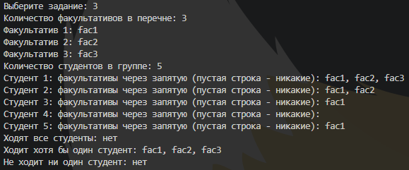
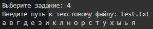
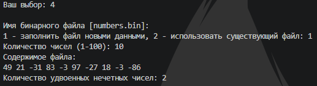
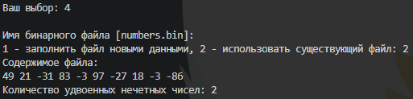
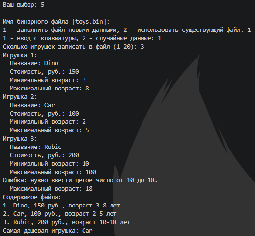
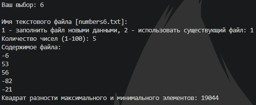
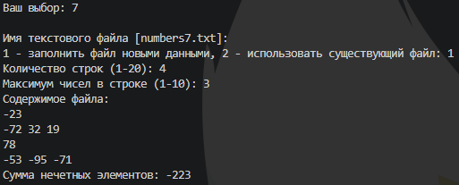
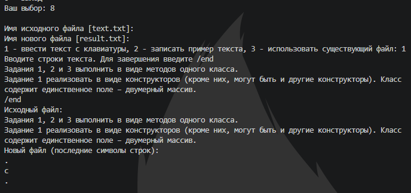

# Сисевич Дмитрий ЛА-4 Лабораторная №3

# Задание 1

## Задача 10

### Текст задачи

Первый массив, размерностью n х m, заполняется данными, вводимыми с клавиатуры, так что заполнение ведется по столбцам от первых элементов столбца к последним.
Второй массив, размерностью n х n, заполняется случайными числами так, что нечетные числа заносятся в элементы массива, которые на шахматной доске были бы черными, а четные числа заносятся в элементы, которые на шахматной доске были бы белыми.
Третий массив, размерностью n х n, заполняется для произвольного n так же, как для n=5:

```
25 24 20 19 11
23 21 18 12 10
22 17 13  9  4
16 14  8  5  3
15  7  6  2  1
```

### Алгоритм решения

Класс `Matrix` содержит единственное поле — двумерный массив `double[,]`. Заполнение реализовано тремя конструкторами:

1. `Matrix(int rows, int columns)` — два вложенных цикла: внешний по столбцам `j`, внутренний по строкам `i` от первой к последней; каждый элемент запрашивается с клавиатуры с проверкой ввода.
2. `Matrix(int size, Random random)` — клетка `[i, j]` считается черной, если `(i + j)` четно (клетка `[0, 0]` — как a1 на доске). Для черной клетки генерируется нечетное число `2k + 1`, для белой — четное `2k + 2`, где `k` — случайное число.
3. `Matrix(int size)` — числа 1, 2, 3, … записываются по диагоналям, параллельным побочной (`i + j = const`), начиная с правого нижнего угла (сумма индексов `2n − 2`) и заканчивая левым верхним. Для диагонали с номером `k` (счет с 0): при четном `k` строки перебираются сверху вниз, при нечетном — снизу вверх (змейка).

### Тестирование


## Задача 10

### Текст задачи

Определите сколько элементов двумерного массива больше любого элемента главной диагонали.

### Алгоритм решения

Метод `CountGreaterThanMainDiagonal` класса `Matrix`: «больше любого элемента диагонали» означает «больше каждого», поэтому достаточно сравнивать с наибольшим элементом главной диагонали. Сначала за один проход по диагонали (длина `min(n, m)`) находится максимум `maxDiagonal`, затем перебираются все элементы массива и подсчитываются те, что строго больше `maxDiagonal`.

### Тестирование



## Задача 10

### Текст задачи

Перегрузить необходимые операторы и посчитать значение матричного выражения А·Cᵀ + B·C. Перегрузить метод ToString() для вывода массива в виде таблицы.

### Алгоритм решения

В классе `Matrix` перегружены операторы `+` и `*` (с проверкой согласованности размеров), реализован метод `Transpose()`, переопределен `ToString()` (элементы форматируются и выравниваются по ширине самого длинного числа). Выражение вычисляется как `a * c.Transpose() + b * c`. Все матрицы квадратные n × n (иначе произведение A·Cᵀ не определено): A вводится с клавиатуры, B и C формируются как в задании 1.

### Тестирование



# Задание 4

## Задача 10

### Текст задачи

Найти количество удвоенных нечетных чисел среди компонент файла.

### Алгоритм решения

Отдельный метод `FillBinaryFile` заполняет бинарный файл случайными целыми числами (`BinaryWriter`). Затем числа считываются `BinaryReader` до конца файла. Число является удвоенным нечетным, если оно четно и его половина нечетна: `value % 2 == 0 && (value / 2) % 2 != 0`. Подсчитывается количество таких чисел.

### Тестирование





# Задание 5

## Задача 10

### Текст задачи

Файл содержит сведения об игрушках: название игрушки, ее стоимость в рублях и возрастные границы (например, игрушка может предназначаться для детей от двух до пяти лет). Получить название самой дешевой игрушки.

### Алгоритм решения

Игрушка описана структурой `Toy` (название, цена, минимальный и максимальный возраст). Отдельные методы заполнения файла (с клавиатуры или случайно) сериализуют каждую структуру в XML (`XmlSerializer`) и записывают получившуюся строку в бинарный файл через `BinaryWriter.Write(string)`. При чтении строки считываются `BinaryReader.ReadString()` и десериализуются обратно в `Toy`. Для поиска самой дешевой игрушки принимается первая игрушка как минимум, затем по списку ищется игрушка с меньшей ценой; выводится ее название.

### Тестирование



# Задание 6

## Задача 10

### Текст задачи

В файле найти квадрат разности максимального и минимального элементов.

### Алгоритм решения

Файл заполняется случайными целыми числами по одному в строке отдельным методом. Числа читаются построчно (пустые строки пропускаются, некорректные значения приводят к сообщению об ошибке), за один проход определяются максимум и минимум, результат вычисляется как `(max − min)²` в типе `decimal` (чтобы избежать переполнения).

### Тестирование



# Задание 7

## Задача 10

### Текст задачи

Вычислить сумму нечётных элементов.

### Алгоритм решения

Файл заполняется случайными целыми числами, по несколько в строке (числа разделены пробелами), отдельным методом. Каждая строка делится на числа методом `Split`, каждое число проверяется на корректность `int.TryParse`. Если `value % 2 != 0`, число прибавляется к сумме (тип `long`).

### Тестирование



# Задание 8

## Задача 10

### Текст задачи

Создать новый текстовый файл, каждая строка которого содержит последний символ соответствующей строки исходного файла.

### Алгоритм решения

Исходный файл заполняется текстом (ввод с клавиатуры до строки `/end` либо пример текста). Файл считывается построчно; для каждой строки в новый файл записывается ее последний символ `line[line.Length - 1]`, а для пустой строки — пустая строка (чтобы сохранить соответствие номеров строк).

### Тестирование


